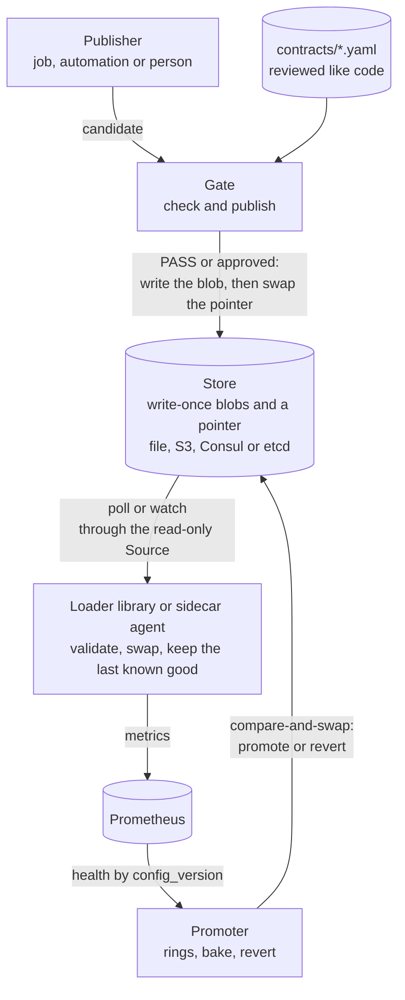
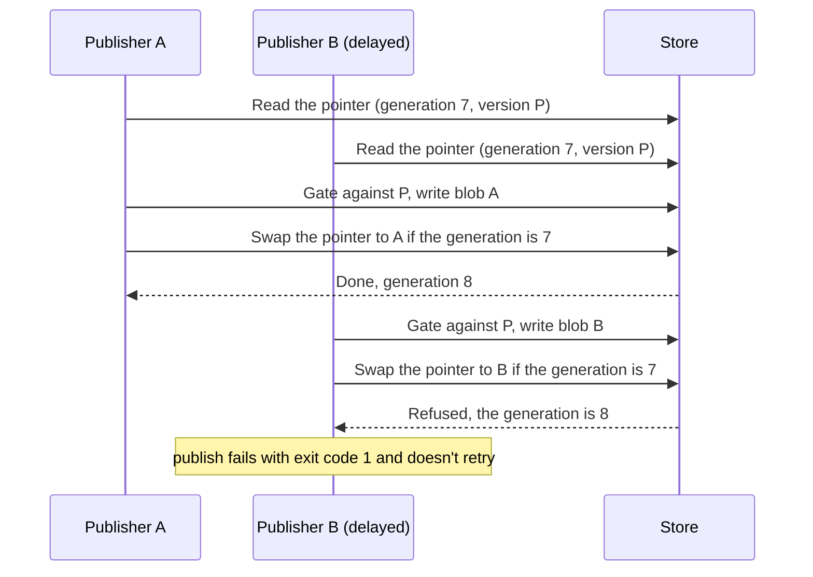
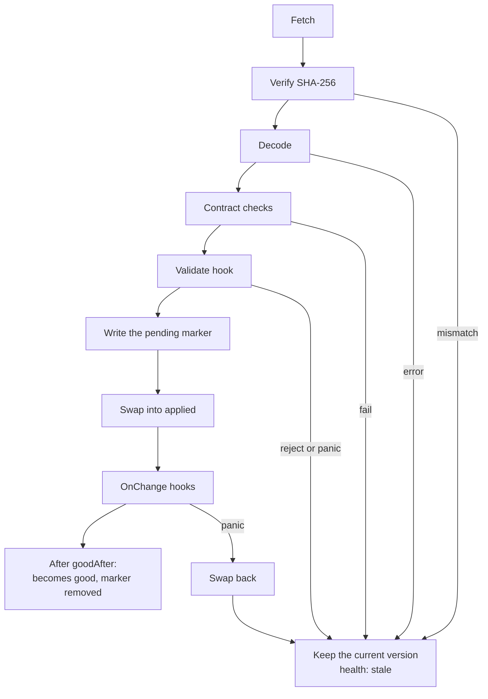

# Architecture

0cular gives config and data changes the safety net that code already has: it checks a change before it's published, keeps the last known good copy when a service loads it, and rolls changes out in rings with automatic revert. This page explains how the parts fit together. The [build plan](BUILD_PLAN.md) has the full design and the schedule, and the [ADRs](adr/README.md) record the decisions.

> **Status: pre-alpha.** This describes the design. Today the repository has the CLI skeleton and the [replay suite](../replay/); the gate arrives in v0.1, the loader in v0.2, publishing in v0.3 and rings in v0.4.

## Overview

0cular sits in three places: in the publisher's path (the gate and publish), in the consumer (the loader library or the sidecar agent), and beside monitoring (the promoter).



| Part | What it does | Ships |
| --- | --- | --- |
| Contract | A reviewed YAML file per artifact: decode caps, JSON Schema, CEL invariants, diff budgets, consumer tests, rings and a failure policy | v0.1 |
| Gate | Checks a candidate against its contract and a baseline: PASS, NEEDS_APPROVAL or BLOCK. Runs as the `0cular check` command, a Go library and a GitHub Action | v0.1 |
| Loader and agent | Applies a new version only if it passes, and keeps the last known good when one doesn't. The agent is a sidecar that writes validated files for apps in any language | v0.2 |
| Store | Write-once blobs and a pointer that changes only by compare-and-swap. `publish` and `revert` go through it | v0.3 |
| Promoter | Moves a version through rings while watching health, and reverts automatically | v0.4 |
| Replay suite | Scenarios shaped like public postmortems that show which part catches which failure | From v0.1 |

## The gate

A candidate goes through the same steps everywhere the gate runs:

1. **Envelope:** the size cap, and decoding under one model for every format: strict, bounded, with no duplicate keys ([ADR-0005](adr/0005-contract-format-and-apiversion-policy.md)).
2. **Schema:** JSON Schema 2020-12.
3. **Invariants:** CEL expressions with cost and time limits ([ADR-0003](adr/0003-contract-language-cel-and-json-schema.md)). These hold absolute limits, such as "at most 200 features".
4. **Diff budgets:** how far a measure may move from the baseline, such as "the feature count changes by at most 20%".
5. **Consumer tests (v0.3):** the real consumer, run on the candidate in a sandbox.

A failure in any step is a BLOCK, except a breached budget, which needs an approval (NEEDS_APPROVAL) unless the budget says it can't be overridden. An approval binds to the candidate's digest, the contract and the breached budgets, so it can't be reused for anything else. The exit codes are 0 for PASS, 1 for BLOCK and 3 for NEEDS_APPROVAL.

## Versions, the pointer and stores

Every version of an artifact is identified by the SHA-256 of its bytes (`sha256:<hex>`). For each artifact, a store holds:

- **Write-once blobs:** the bytes of every version, each with a write-once metadata object (parent, contract hash, gate result, approvals, publisher and time).
- **One pointer:** a small JSON object naming the current version. Its `generation` goes up on every change, which is what compare-and-swap checks.

```json
{
  "formatVersion": 1,
  "artifact": "bot-features",
  "generation": 57,
  "version": "sha256:bb…",
  "parent": "sha256:aa…",
  "updatedAt": "2026-10-09T15:04:05Z",
  "updatedBy": "publisher"
}
```

In v0.4 the pointer's format 2 adds the rollout manifest: which ring gets which version, the fleet's last known good, and rejected versions. A loader that doesn't know a pointer's `formatVersion` keeps its last known good, so an old loader can never bypass the rings.

Loaders depend only on the read-only `Source`; publishers and the promoter use `Store` ([ADR-0004](adr/0004-store-interface-and-versioning.md)):

```go
type Source interface {
    Pointer(ctx context.Context, artifact string) (Pointer, error)
    Blob(ctx context.Context, artifact string, v Version) ([]byte, error)
}

type Store interface {
    Source
    PutBlob(ctx context.Context, artifact string, data []byte, meta Meta) (Version, error) // write-once
    CompareAndSwapPointer(ctx context.Context, artifact string, next Pointer, expectedGeneration uint64) error
    History(ctx context.Context, artifact string, limit int) ([]Meta, error)
}
```

**Publish asserts its parent.** It reads the pointer, gates the candidate against the version the pointer names, writes the blob, and swaps the pointer only if the pointer hasn't moved. A delayed writer, like the one in AWS's DynamoDB DNS outage, fails instead of overwriting newer data:



Each adapter maps these operations onto its backend's conditional writes:

| Adapter | Write-once blob | Pointer compare-and-swap | Size limit |
| --- | --- | --- | --- |
| `file` | Content-addressed files | Atomic rename plus a lock file | Disk |
| `s3` | `If-None-Match: *` | `If-Match` with the pointer's ETag | 5 GB per PUT |
| `consul` | `?cas=0` | `?cas=<ModifyIndex>` | 512 KB per value |
| `etcd` | Transaction on `create_revision = 0` | Transaction comparing `mod_revision` | 1.5 MiB per request |

`store verify` probes that a backend really refuses a stale write and a repeated write-once write, and `publish` refuses a store that fails the probe.

## The loader

The loader runs inside the consumer, so its first rule is that it never crashes, blocks or leaks in the host process. It keeps two slots:

- **`applied`:** the last version swapped in.
- **`good`:** the last known good (LKG), a version that stayed applied for `goodAfter` (10 minutes by default) with no crash or hook failure.

A new version must pass every step before it's served. Any failure keeps the current version and reports `stale`:



**Start.**
1. Load both slots and verify their SHA-256.
2. Re-validate the last known good against the current contract. If it fails, there's no LKG, unless the contract sets `onFailure.trustLastKnownGood: true`.
3. Check for a pending marker. One found at start means the process died during or soon after a swap: the crash-loop shape of the CrowdStrike and Google incidents. So the loader serves `good`, and skips that version until a newer one is assigned. Without a marker, it serves `applied`.
4. Fetch the assigned version.

**Steady state.** The loader polls with jitter, or watches when the store supports it. Fetch errors back off exponentially, capped at `pollEvery`.

**No last known good.** Under `onFailure.noLastKnownGood: closed` (the default), `Start` returns an error and the app decides what to do. Under `open`, a default value is served and health reports `degraded`.

**On disk** (`<cacheDir>/<artifact>/`): `blobs/<sha256>.bin`, `state.json` (both slots and the skipped versions), `pending.json` and, from v0.3, a `PIN` file for the break-glass pin. Every write goes to a temporary file, is synced and renamed, then the directory is synced (except on Windows, which doesn't support that). Retention keeps the last three blobs, and never removes `good`, the fleet's last known good or a pinned version.

**Health and metrics.** `Health()` returns `ok`, `stale`, `degraded`, `lkg_invalid` or `failed`. Only `failed` means not ready. Use it for readiness, never for liveness: restarting a process that's serving its last known good loses that state and makes an outage worse. Metrics use the `zerocular_` prefix, because a Prometheus metric name can't start with a digit ([ADR-0001](adr/0001-name-owner-and-module-path.md)):

| Metric | Type | Labels |
| --- | --- | --- |
| `zerocular_config_info` | gauge (=1) | artifact, config_version, ring, instance_id |
| `zerocular_loads_total` | counter | artifact, result |
| `zerocular_check_failures_total` | counter | artifact, check |
| `zerocular_stale` | gauge (0 or 1) | artifact |
| `zerocular_last_success_timestamp_seconds` | gauge | artifact |

Application metrics don't need a version label: a PromQL join on `zerocular_config_info` attributes errors to the version each instance serves, which is what the promoter compares across rings.

**The agent** embeds the loader as a sidecar. It writes the current validated version atomically to a file in a shared directory, optionally signals the app, and serves `/readyz` once the first valid file exists. An app in any language then reads a file that's always valid.

## Security boundaries

- **Least privilege.** Publishers can write blobs and the pointer, loaders only read through `Source`, and the promoter can write only the pointer.
- **Untrusted artifacts.** Artifacts are size-capped and strictly decoded, nothing in them is executed, and every report escapes their contents.
- **Integrity.** The loader verifies the SHA-256 of every version it loads.
- **Contracts are code.** They're reviewed and owned. Consumer-test commands come only from contracts, never from artifacts.

See [SECURITY.md](../SECURITY.md) to report a vulnerability.

## Repository layout

```text
cmd/0cular/   the CLI
contract/     contract types, strict loading, lint (v0.1)
eval/         decoding, schema, CEL invariants, budgets (v0.1)
gate/         the check API and approvals (v0.1)
report/       text, Markdown and JSON reports (v0.1)
action/       the GitHub Action (v0.1)
loader/       the loader library (v0.2)
agent/        the sidecar agent (v0.2)
store/        Source, the pointer format, sources and adapters (v0.2 and v0.3)
rollout/      the manifest, ring resolver and promoter (v0.4)
internal/     shared internals and development tools
replay/       postmortem-shaped scenarios and their tests
examples/     sample consumers and a demo (v0.2)
docs/         this page, the build plan and the ADRs
```
